


 

 


  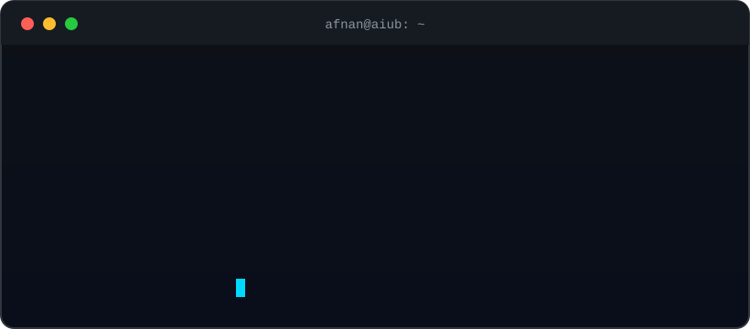

 

<table width="100%">
  <tr>
    <td width="33%" valign="top" align="center">
      <h3>🎓 Education</h3>
      Computer Science &amp; Engineering 
      <b>American International University-Bangladesh (AIUB)</b>
    </td>
    <td width="33%" valign="top" align="center">
      <h3>🧠 Interests</h3>
      Software &amp; web development 
      AI &amp; machine learning 
      Data structures &amp; algorithms
    </td>
    <td width="33%" valign="top" align="center">
      <h3>🎮 Off the keyboard</h3>
      Chess ♟️ · Cricket 🏏 
      Anime 🎌 · Video games 🎮
    </td>
  </tr>
</table>

 


<table width="100%">
  <tr>
    <td width="22%" align="center"><b>Languages</b></td>
    <td></td>
  </tr>
  <tr>
    <td align="center"><b>Web &amp; Database</b></td>
    <td></td>
  </tr>
  <tr>
    <td align="center"><b>Tools</b></td>
    <td></td>
  </tr>
  <tr>
    <td align="center"><b>Concepts</b></td>
    <td>
      
      
      
      
      
    </td>
  </tr>
</table>

 


<!--PROJECTS:START-->
<!-- Auto-generated daily by .github/workflows/update-readme.yml -->

<table width="100%">
  <tr><td width="50%"></td><td width="50%"></td></tr>
  <tr><td width="50%"></td><td width="50%"></td></tr>
  <tr><td width="50%"></td><td width="50%"></td></tr>
</table>

🔎 **[Browse all my public repositories](https://github.com/Afnan-Ghoni-Brinto?tab=repositories)**

<!--PROJECTS:END-->

 


<table width="100%">
  <tr>
    <td width="50%"></td>
    <td width="50%"></td>
  </tr>
</table>


  



  


  <picture>
    <source media="(prefers-color-scheme: dark)" srcset="https://raw.githubusercontent.com/Afnan-Ghoni-Brinto/Afnan-Ghoni-Brinto/output/github-contribution-grid-snake-dark.svg"/>
    <source media="(prefers-color-scheme: light)" srcset="https://raw.githubusercontent.com/Afnan-Ghoni-Brinto/Afnan-Ghoni-Brinto/output/github-contribution-grid-snake.svg"/>
    
  </picture>

 


<table width="100%">
  <tr>
    <th width="34%">🔭 Focus</th>
    <th>🎯 Goal</th>
  </tr>
  <tr>
    <td><b>Data Structures &amp; Algorithms</b></td>
    <td>Practice consistently and get faster at solving problems</td>
  </tr>
  <tr>
    <td><b>Web &amp; Software Development</b></td>
    <td>Build and publish real projects, not just tutorials</td>
  </tr>
  <tr>
    <td><b>AI &amp; Machine Learning</b></td>
    <td>Learn the fundamentals and try small experiments</td>
  </tr>
</table>

 


  <i>Always happy to learn together, collaborate on projects and meet new people. Say hi!</i>

    

  
  
  
  
  

    

  **`Keep learning. Keep building. Keep improving.`**

